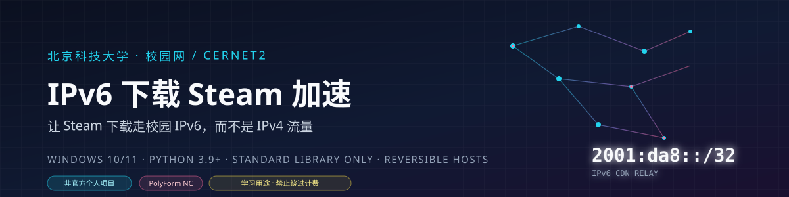
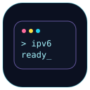
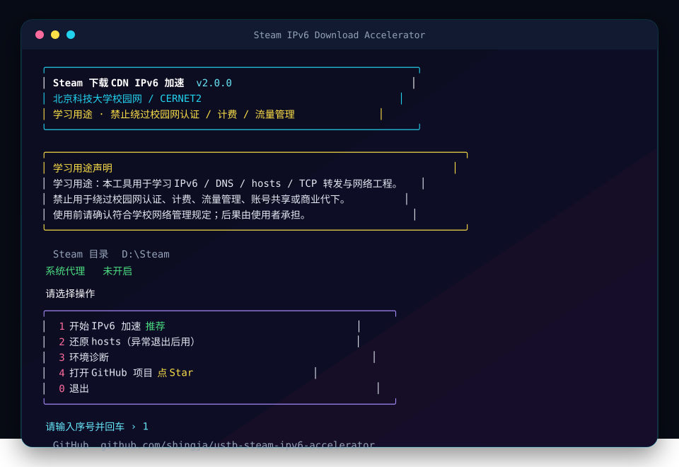

<!-- 作者 shingja · github.com/shingja/shingja-steam-ipv6-accelerator · PolyForm Noncommercial 1.0.0 · 保留版权标识⁠​‌‌‌​​‌‌​‌‌​‌​​​​‌‌​‌​​‌​‌‌​‌‌‌​​‌‌​​‌‌‌​‌‌​‌​‌​​‌‌​​​​‌​​‌​‌‌‌‌​‌‌‌​​‌‌​‌‌​‌​​​​‌‌​‌​​‌​‌‌​‌‌‌​​‌‌​​‌‌‌​‌‌​‌​‌​​‌‌​​​​‌​​‌​‌‌​‌​‌‌‌​​‌‌​‌‌‌​‌​​​‌‌​​‌​‌​‌‌​​​​‌​‌‌​‌‌​‌​​‌​‌‌​‌​‌‌​‌​​‌​‌‌‌​​​​​‌‌‌​‌‌​​​‌‌​‌‌​​​‌​‌‌​‌​‌‌​​​​‌​‌‌​​​‌‌​‌‌​​​‌‌​‌‌​​‌​‌​‌‌​‌‌​​​‌‌​​‌​‌​‌‌‌​​‌​​‌‌​​​​‌​‌‌‌​‌​​​‌‌​‌‌‌‌​‌‌‌​​‌​​​‌​‌‌‌‌​​‌‌​​‌​​​‌‌​​​​​​‌‌​​‌​​​‌‌​‌‌​​​‌​‌‌‌‌​‌‌‌​‌‌​​​‌‌​​​‌⁠ -->

<div align="center">
  
</div>

<div align="center">
  
  
  
  
</div>


# 北京科技大学校园网 IPv6 下载 Steam 加速

**让 Steam 下载走校园网 IPv6，而不是 IPv4 流量。**

> **学习用途**：本项目用于学习 IPv6、DNS、hosts、TCP 转发与网络工程。**不是**绕过校园网认证、计费、流量管理或账号共享的工具。禁止转售、代下、代加速或商用。使用前确认符合学校规定；后果由使用者承担。详见 [使用边界与合规](docs/10-使用边界与合规.md)。

> **唯一官方地址**：https://github.com/shingja/shingja-steam-ipv6-accelerator

> 公开版只提供 EXE 与使用说明；源码与开发维护不在公开包内。

## 这是什么

一个 Windows 小工具，解决一个具体问题：

> 校园网有 IPv6，Steam 下载却只走 IPv4；有时还会遇到 DNS 不返回 AAAA、下载一直“无下载源”。

本工具把 Steam 当前使用的内容下载 CDN 域名，通过 hosts 指向本机回环地址；程序监听 80 端口，把连接转发到该 CDN 的 IPv6 节点。Steam 看到的是本地 IPv4 连接，实际数据走 IPv6 出口。

- 单文件 EXE，内置 Python，不需要安装 Python 或 BAT。
- 只改 `hosts` 中带标记的一段，退出自动还原。
- 只监听 `127.0.0.20` 起的回环地址，不对局域网开放。
- 不修改 Steam 客户端、游戏文件，不读取账号、Cookie、令牌。

## 它解决什么问题

| 现象 | 原因 | 本工具的处理 |
|---|---|---|
| Steam 一直“无下载源”，DNS 解析失败 | 校园网 DNS（如 `202.204.52.94`）可能不返回 CDN 域名的 AAAA | 直接向多个 IPv6 公共 DNS 查询 AAAA，绕开系统 DNS |
| CDN 域名经常变化，内置列表失效 | CDN 调度会更新域名 | 从 Steam 官方内容服务器目录 API 动态获取，并保留备用列表 |
| 某个 CDN 节点不可用，整个下载卡住 | 单点失败会挂起连接 | 只映射实测可用域名；转发失败返回 502，让 Steam 自动换源 |
| 主域名走 IPv6，302 跳转后的二级域名又走 IPv4 | 只处理主域名会漏掉跳转域名 | 自动解析并加速跳转域名，支持从 Steam 日志发现新域名 |
| Steam 自带 IPv6 检测把“纯 hosts 指向 IPv6”降级成 IPv4 | Steam 的连通性检测逻辑 | 采用本机回环转发，让 Steam 认为连接是 IPv4 本地连接 |

## 特性

- **自动发现 CDN**：Steam 内容服务器目录 API + 内置大陆 CDN 备用列表。
- **多 DNS 查询**：阿里、腾讯、Google、Cloudflare 的 IPv6 DNS，必要时用 IPv4 DNS 补充候选。
- **实测选点**：对每个域名解析多个地址，发 HTTP 探测，按延迟选可用节点。
- **防 IPv4 泄露**：处理已知 CDN 302 跳转域名，并从 Steam `content_log.txt` 自动发现新跳转域名。
- **失败快速回退**：上游连不上就返回 502，Steam 会换源，不会卡死。
- **可还原**：hosts 修改带 `BEGIN/END` 标记；正常退出、菜单还原都能清理。
- **系统代理处理**：检测到系统代理时询问是否临时关闭，退出时恢复。
- **终端界面**：中文宽度对齐、彩色面板、启动学习用途声明；`--no-color` 纯文本输出。
- **单文件 EXE**：内置 Python，双击即用；菜单包含开始/还原/诊断/打开 GitHub。

## 快速开始

1. 从发布页下载 `SteamIPv6Accelerator-v1.0.0.exe`，或直接使用仓库根目录的 exe。
2. 双击运行。
3. 选择 `1`；首次加速输入 **“同意”** 确认学习用途声明。
4. 关闭系统代理，等待选点完成。
5. 重启 Steam，开始下载；保持窗口打开。
6. 下载完成后按回车，自动还原 hosts。

菜单：

```text
1  开始 IPv6 加速
2  还原 hosts
3  环境诊断
4  打开 GitHub 项目
0  退出
```

命令行可选：

```bat
SteamIPv6Accelerator-v1.0.0.exe --diagnose
SteamIPv6Accelerator-v1.0.0.exe --restore
SteamIPv6Accelerator-v1.0.0.exe --fingerprint
SteamIPv6Accelerator-v1.0.0.exe --report
SteamIPv6Accelerator-v1.0.0.exe --github
```

## 界面预览

<div align="center">
  
</div>

## 如何确认真的走了 IPv6

1. 程序窗口列出的上游地址是 `[2001:...]` 或 `[240e:...]` 等 IPv6 字面量。
2. Steam `logs/content_log.txt` 里出现 `127.0.0.20`、`127.0.0.21` 等本机地址。
3. 程序窗口的累计流量随下载增长。
4. 程序菜单 `3` 环境诊断，确认 IPv6 DNS 与出口可用。

注意：Steam 自带的 IPv6 连通性检测会把“纯 hosts 指向 IPv6”降级成 `ipv4-only`，所以不能只看 Steam 设置里的 IPv6 开关；本工具用本机回环转发绕开这一点。

## 知识架构

| 层 | 学什么 |
|---|---|
| 网络基础 | IPv6、DNS AAAA、HTTP、CDN 302 |
| 系统层 | hosts、回环地址、UAC、系统代理 |
| 转发层 | TCP 转发、502 回退 |
| 应用层 | Steam API、content_log、CDN 选点 |
| 工程化 | 诊断、报告、发布 |

## 公开包结构

```text
.
├─ SteamIPv6Accelerator-v1.0.0.exe   # 主程序，双击即用
├─ EXE-SHA256SUMS                   # 校验
├─ README.md
├─ docs/                            # 使用、FAQ、排障、合规、反馈
├─ assets/                          # banner、贴纸、界面图
├─ LICENSE
├─ NOTICE.md
├─ CITATION.cff
└─ VERSION
```

## 不适用与限制

- **仅 Windows**：依赖 `hosts`、注册表和 `ipconfig`。
- **只加速 Steam 下载 CDN**：不代理网页、不加速游戏联机、不影响 Steam 商店。
- **需要校园网 IPv6**：没有 IPv6 出口时无法使用。
- **部分 CDN 二级域名没有 IPv6 节点**：例如 `trts.baishancdnx.cn`，这部分仍走 IPv4，属于 CDN 侧限制。
- **速度不保证**：实测与 IPv4 直连相当；高峰期、节点负载、学校出口策略都会影响。
- **不绕过计费/认证**：只改变下载流量的 IP 协议出口。使用前请确认符合学校网络管理规定。

## 常见问题

- 加速后没有下载源：菜单 `2` 还原 hosts，重启 Steam，再重新加速。
- 加速后反而变慢：按回车停止，Steam 会回到 IPv4。
- hosts 没还原：菜单 `2` 或运行 `--restore`。
- 更多问题：[docs/03-常见问题.md](docs/03-常见问题.md)、[docs/07-故障排查.md](docs/07-故障排查.md)。

## 文档

- [使用指南](docs/00-使用指南.md)
- [原理与边界](docs/01-原理与边界.md)
- [快速开始](docs/02-快速开始.md)
- [常见问题](docs/03-常见问题.md)
- [实测记录](docs/05-实测记录.md)
- [第三方工具与致谢](docs/06-第三方工具与致谢.md)
- [故障排查](docs/07-故障排查.md)
- [使用边界与合规](docs/10-使用边界与合规.md)
- [反馈与建议](docs/13-更新与贡献.md)

## 第三方与致谢

- **Dogfight360 / 羽翼城**：下载 CDN 重定向工具的作者。本项目受其公开思路与资料启发，是独立重写，不是官方续作，也不代表原作者背书。
- **Steamcommunity_302 / UsbEAm Hosts Editor**：不内嵌、不分发，只给官方来源。
- **Valve / Steam**：Steam 名称与相关商标归 Valve Corporation 所有。
- **北京科技大学**：校名归学校所有；本项目为个人项目，与学校无隶属、合作或背书关系。

## 许可

PolyForm Noncommercial License 1.0.0，见 [LICENSE](LICENSE)。非商业使用免费；商业使用需书面授权；不得冒充原创或暗示背书。

## 作者

- GitHub: [@shingja](https://github.com/shingja)
- 邮箱: [gy79790920@126.com](mailto:gy79790920@126.com)

---

<div align="center">

如果这个工具帮你省了流量，点一个 **Star** 支持一下。

*不必要做的不做，必要做的尽快做。*

<sub>© 2026 shingja · PolyForm Noncommercial 1.0.0 · 非官方项目</sub>

</div>
